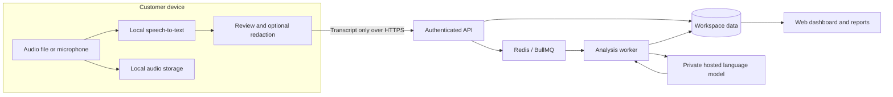

# Proposed hybrid architecture: local transcription, hosted intelligence

This is the next design, **not the current transcription implementation**. Today, uploaded/imported audio is stored and transcribed on the service. The current UI and privacy copy describe that behavior.

## Recommended boundary

Run speech-to-text on the customer’s device. Send the transcript and chosen metadata to MeetingBrief for summaries, decisions, actions, embeddings and question answering. Keep raw audio on the device by default.

Whisper is itself an AI model: its weights must run locally for this boundary to hold. Only cleaning, compressing or resampling audio on the laptop would still require uploading audio to a hosted transcription model.

A transcript contains sensitive content too. Hosted analysis requires the server to read it in memory; this is not end-to-end encryption. The benefit is avoiding raw-audio transfer/storage and giving the customer a chance to review what leaves the device.

## Client implementation choices

For a web-first beta, use a browser-compatible Whisper implementation with WebGPU acceleration and a WASM/CPU fallback. Download and cache a supported model once; show the download size, readiness and measured progress. Test Chrome/Edge, Safari, weaker CPUs, long recordings and low-memory devices before promising broad support. Never silently fall back to cloud transcription when local inference is unavailable.

For reliable long meetings and direct provider downloads, a Tauri desktop companion with whisper.cpp is a stronger later option. It can use native compute, OS-managed file access and a keychain. The web dashboard can remain the common interface, but a desktop installation introduces onboarding friction.

For in-person meetings, the initial workflow can remain a phone/laptop recorder followed by opening that local file. A future microphone recorder uses explicit consent, HTTPS microphone permission, pause/stop, preview and local saving. Offline transcription requires the application and model to have been downloaded first; hosted analysis waits until connectivity returns.

## Data ownership and storage

| Data | Default location | Notes |
|---|---|---|
| Raw audio | Customer device | No automatic cloud backup. Local loss is possible; provide export/backup guidance. |
| Working transcript before submit | Device | Allow edits and optional redaction before sending. |
| Submitted transcript and metadata | Private cloud database | Tenant scoped; encrypted storage/backups; retention chosen and disclosed. |
| Summaries, decisions, actions and Q&A | Private cloud database | Same workspace access and deletion boundaries as the transcript. |
| Search embeddings | Private cloud database | Sensitive derived data; delete alongside source content. |
| Account and key records | Cloud database | Salted password hashes, hashed API keys, revocable sessions and permissions. |
| Model weights | Device cache / server model storage | Weights are separate from customer recordings. |

Keep the current MongoDB/Redis/BullMQ stack initially. Add meeting processing mode, transcript revision/hash, source duration, language and analysis state to the recording metadata. Local-mode records have no server audio path. Audio playback reopens the local file or a local file handle; the cloud cannot promise cross-device playback without an explicit audio upload.

## API and worker changes

1. Create recording metadata with `processing_mode=local` and an idempotency key.
2. Submit bounded, validated transcript segments to a new write-protected endpoint. Validate finite timestamps, text lengths, ordering, segment counts and workspace access. Client-reported duration is metadata, not a billing authority.
3. Complete a transcript revision atomically and enqueue analysis once. Retrying a network request must not create duplicate recordings or charge twice.
4. Reuse the analysis/indexing worker, bypassing server transcription for local-mode records. Show actual pending/processing/completed/failed states and cancellation/retry behavior.
5. Persist results under the same workspace. Treat transcripts and model output as untrusted data, never executable instructions. Preserve evidence timestamps for local playback.
6. Allow local-only customers to delete all submitted transcript, derived content, embeddings and Q&A. Define how cancellation, pending jobs and backup retention interact with deletion.

Do not bill based only on audio minutes reported by a customer-controlled client. Meter actual hosted inference usage or server-validated processing credits. Enforce atomic workspace budgets before jobs run; IP rate limits alone do not prevent distributed cost abuse. Stripe can later manage entitlements, but checkout redirects must not grant access without verified webhook state.

## Provider import caveat

The existing Zoom/Google Meet/Webex flow downloads recordings through the backend. It cannot be advertised as “raw audio never reaches our servers.”

For the hybrid mode, prefer a provider-supported direct download to the device, or a desktop companion. Provider CORS and download-authentication rules differ. Never expose server client secrets or long-lived provider refresh tokens to the browser to work around these restrictions. A temporary server proxy still receives raw audio; it needs explicit disclosure and opt-in. Manual download from the provider followed by local transcription is the simplest honest first version where direct import is unavailable.

## Delivery sequence

- Benchmark a local transcription proof of concept on representative laptops and recordings. Measure model download, memory use, transcription speed and accuracy.
- Add transcript-only ingestion and reuse the existing hosted analysis pipeline.
- Add local-file playback, review/redaction, recovery and retention controls.
- Test every advertised browser/device and the full deletion/isolation path.
- Adapt provider imports explicitly, then consider the native companion if long recordings or provider restrictions justify it.

Keep hosted-audio mode separate and clearly labeled throughout this transition. Market only the data boundary implemented by the selected mode.
