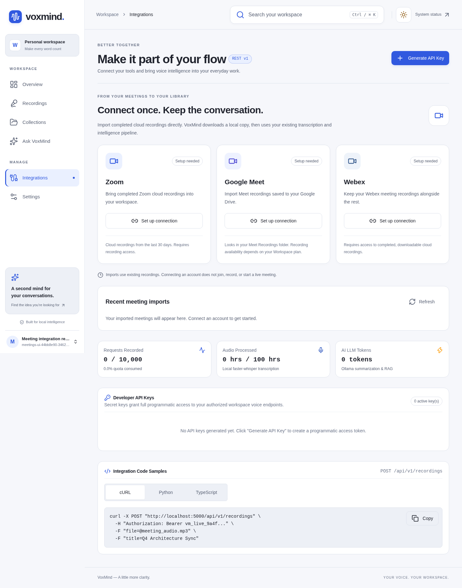

# Import meeting recordings



VoxMind can connect to Zoom, Google Meet (through Google Drive), and Webex. Open **Integrations**, connect your account, choose **Browse recordings**, then **Import recording**. The backend downloads a local copy, records its provider, and queues the same transcription, analysis, and indexing used by uploaded files. The import history distinguishes queued, downloading, imported, and failed downloads. “Imported” means the file reached your library and the transcription job was queued; check the recording page for transcription and analysis status.

This imports existing cloud recordings. It does not join meetings, start a recording, capture browser audio, or automatically import every future meeting. The provider must have finished processing a recording and your account must be allowed to download it. Connections belong to the signed-in user in the current workspace; imported recordings are workspace resources. The same provider recording is imported only once per workspace, including concurrent requests.

## Server setup

With the one-command Docker workflow (`npm start` in the project root), the encryption key is generated automatically in the root `.env`. Add provider client IDs and secrets to that file and run `npm start` again. You do not need to run the native setup commands below. Keep the same encryption key across restarts. Missing integration settings are copied from an existing `backend/.env` on startup; existing root values take precedence.

For native development, use the following setup instead.

Use the normal native development workflow with MongoDB and Redis running. In `backend`:

```sh
npm ci
npm run integrations:key
```

The key command creates `INTEGRATION_ENCRYPTION_KEY` in the ignored `backend/.env`, preserving any existing settings and existing key. It never prints the key. Keep that file private and retain the same key across restarts: connected account tokens are encrypted with AES-256-GCM. Changing or losing the key requires reconnecting accounts. Do not copy keys or OAuth credentials into chat, frontend variables, source control, or logs.

Add the app settings for the providers you want to enable to `backend/.env`. All values remain on the backend:

| Provider    | Required app settings                      |
| ----------- | ------------------------------------------ |
| Zoom        | `ZOOM_CLIENT_ID`, `ZOOM_CLIENT_SECRET`     |
| Google Meet | `GOOGLE_CLIENT_ID`, `GOOGLE_CLIENT_SECRET` |
| Webex       | `WEBEX_CLIENT_ID`, `WEBEX_CLIENT_SECRET`   |

Also set:

```dotenv
INTEGRATIONS_API_BASE_URL=http://localhost:5000
FRONTEND_URL=http://localhost:5173
```

Restart the backend after changing settings. The UI shows **Setup needed** until a provider's client ID, client secret, and valid encryption key are present. It shows **Not connected** until the user completes OAuth; configuration alone never establishes a connection. `GOOGLE_APPLICATION_CREDENTIALS` is not a substitute for a user-authorized Google OAuth client.

Register each redirect URL exactly in the corresponding provider app:

| Provider | Local redirect URL                                                       |
| -------- | ------------------------------------------------------------------------ |
| Zoom     | `http://localhost:5000/api/v1/meeting-integrations/zoom/callback`        |
| Google   | `http://localhost:5000/api/v1/meeting-integrations/google-meet/callback` |
| Webex    | `http://localhost:5000/api/v1/meeting-integrations/webex/callback`       |

For deployment, use your public HTTPS API/reverse-proxy origin for `INTEGRATIONS_API_BASE_URL` and your frontend origin for `FRONTEND_URL`. Register those callback URLs, not the localhost URLs. Prefer serving frontend and `/api` under the same public origin. OAuth requires the browser's HttpOnly SameSite=Lax state cookie; do not mix `localhost` and `127.0.0.1` during a flow. Set `CORS_ORIGIN` to the frontend origin if using separate origins. The Compose backend accepts the same optional settings through its environment; provide them via your deployment's secret/environment configuration.

## Zoom

Create a **user-authorized OAuth app** in the [Zoom App Marketplace](https://marketplace.zoom.us/). Server-to-server OAuth credentials are not interchangeable with this flow. Register the redirect URL and configure recording permissions. The API operations used are listing the current user's cloud recordings, listing a meeting's recording files, and downloading recording media. Granular app scopes:

- `cloud_recording:read:list_user_recordings`
- `cloud_recording:read:list_recording_files`
- `cloud_recording:read:download_recording`

Account administrators may need to approve app installation. A Zoom plan with cloud recording and access to the host's recordings is required. VoxMind lists the last 30 days, supports pagination, and prefers an M4A audio track over an MP4 video for each meeting occurrence. Local recordings that were never uploaded to Zoom are not available through this API; use the normal file upload instead.

References: [Zoom OAuth](https://developers.zoom.us/docs/integrations/oauth/), [Zoom meeting APIs](https://developers.zoom.us/docs/api/meetings/).

## Google Meet through Drive

Create a web OAuth client in Google Cloud, enable the **Google Drive API**, configure the OAuth consent screen, add test users while the app is in testing, and register the Google redirect URL. VoxMind requests `https://www.googleapis.com/auth/drive.readonly` with offline access and PKCE. This is a restricted Google scope; public distribution may require Google's verification and your Workspace administrator's approval. The client secret stays on the server.

Meet saves recording videos to Google Drive. VoxMind searches the connected account's **Meet Recordings** folders and lists downloadable audio/video files. If the folder was renamed, localized, or moved to a shared location, use **Use a different Drive folder** in the recording browser and enter the folder ID from its Drive URL. Use the organizer's account, or an account with access to the recording folder. Recording support depends on your Google Workspace edition. Connecting Google does not enable recording on an otherwise unsupported account.

References: [Google OAuth web-server flow](https://developers.google.com/identity/protocols/oauth2/web-server), [Drive files API](https://developers.google.com/drive/api/reference/rest/v3/files), [Meet recording storage](https://support.google.com/meet/answer/9308681).

## Webex

Create an integration in [Webex for Developers](https://developer.webex.com/my-apps), register the Webex redirect URL, and grant `meeting:recordings_read`. Use its client ID and client secret. Your Webex account must have recording and download permissions. The connector lists accessible recordings and requests recording details for a fresh `temporaryDirectDownloadLinks` audio or recording link. It does not download an HTML playback page or bypass disabled downloads, passwords, retention policies, or account restrictions.

References: [Webex integrations](https://developer.webex.com/docs/integrations), [Recording APIs](https://developer.webex.com/docs/api/v1/recordings).

## Operation and recovery

- Run the backend normally with `npm run dev` or `npm start`. It starts a `meeting-imports` BullMQ worker in addition to the existing audio and AI workers. Redis and MongoDB are required.
- Each file is limited by `MAX_UPLOAD_SIZE_MB` (100 MB by default), including streamed downloads with no Content-Length. Raise the setting deliberately for large video recordings and provision disk space accordingly.
- Download redirects are checked against provider domains, HTTPS is required, and OAuth headers are removed on cross-origin redirects. Unsupported provider CDN addresses fail explicitly; inspect the provider's current documented delivery domains before extending the allowlist in `download.ts`.
- Imports run in the background and use fresh provider download URLs. Failed imports can be retried. A failed handoff to the audio queue reuses the retained local recording instead of downloading a second copy.
- Connecting a provider does not configure local Whisper, embedding models, or Ollama. Those existing AI prerequisites are still required for transcription and generated insights. MP4 recordings are decoded by the AI service's PyAV/faster-whisper path.
- Expired access tokens are refreshed automatically when refresh credentials exist. Refresh requests use an expiring MongoDB lease and conditional updates so parallel API/worker requests and multiple backend processes do not reuse the same rotating refresh token.
- Disconnect removes VoxMind's saved connection and pending OAuth states; it keeps already imported recordings. Queued imports without downloaded media will fail if their connection was removed. Revoke the app in the provider's account settings as well if you want to remove the provider-side grant.
- If a provider denies a scope, app, plan, or account permission, reconnect only after correcting that prerequisite. No recording is claimed to be imported before its local file is saved and processing is queued.

OAuth callbacks validate an expiring, one-use state and a browser cookie. OAuth codes and session/redirect headers are excluded from HTTP logs. Provider API failures are sanitized instead of logging Axios request configs containing credentials. Browser responses contain recording metadata and local import status, never provider tokens, credentials, or signed download URLs.

## Validation

```sh
npm run build --prefix backend
npm test --prefix backend
npm run lint --prefix frontend
npm run build --prefix frontend
npm run test:meetings --prefix frontend
```

Backend tests use an isolated MongoDB, fixture OAuth/provider responses, bounded streaming download tests, and a mocked transcription queue. They exercise all three connectors, callback replay/expiry/browser binding, encryption, account isolation, concurrent duplicate imports, queue-handoff retry, and token refresh. Browser tests cover actual unconfigured states and fixture recording-list/import/disconnect flows. These checks do not prove access to a live Zoom, Google, or Webex tenant. Complete a real OAuth connection and recording import with your configured provider apps before treating that provider as verified in your deployment.
