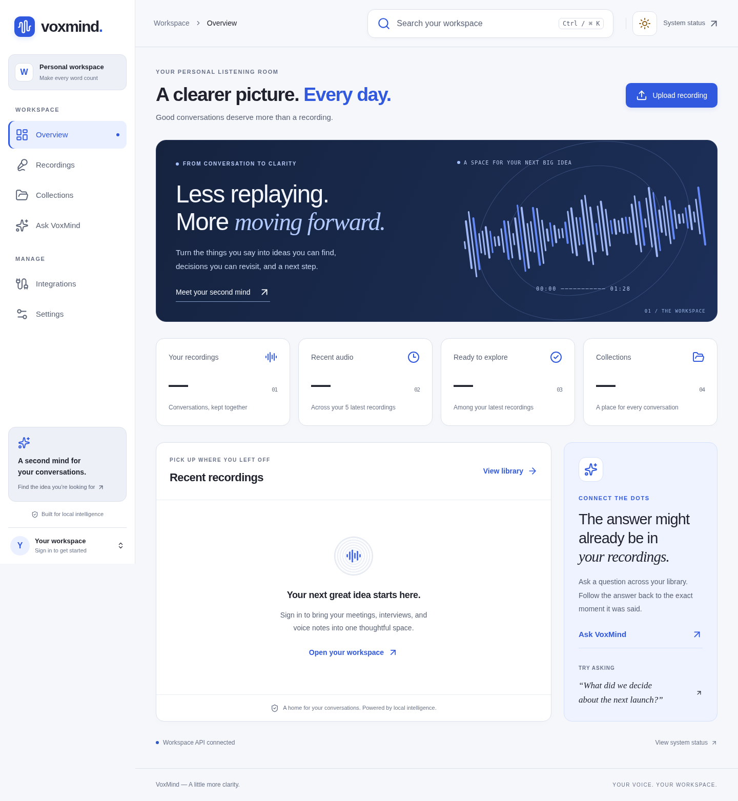

# VoxMind frontend

React, TypeScript, Vite, and Tailwind. The interface uses a white, slate, and cobalt palette with an audio waveform signature. Both light and dark themes are supported.



[View the mobile layout](docs/workspace-mobile.png)

## Develop

Use Node.js 22 or newer.

```sh
npm ci
npm run dev
```

Vite requires port 5173 to be free and stops with an error if another server is already using it. This prevents accidentally opening an older frontend. It listens on port 5173 and proxies `/api` to the Express backend on port 5000. Start MongoDB and Redis with `docker compose up -d mongo redis` from the repository root, then run `npm run dev` in `backend`. Register an account through the UI; the client does not automatically use demo credentials. The existing Python AI service is needed for transcription, embeddings, and generated answers.

```sh
npm run lint
npm run build
npm run preview
```

## Structure

- `src/app/`: application providers and lazy route definitions.
- `src/features/`: domain pages grouped into auth, workspace, recordings, collections, intelligence, integrations, and settings. Domain-specific components live beside their pages.
- `src/components/`: shared UI primitives, application layout, and visual brand components.
- `src/contexts/` and `src/hooks/`: shared state and reusable behavior.
- `src/lib/`: typed API client and general utilities.
- `src/styles/`: theme tokens and responsive application styles. `src/index.css` imports these and declares Tailwind theme mappings.

The application shell remains mounted during route transitions. Navigation switches to an accessible modal drawer below 1024px. Layouts use fluid grids, independently scrollable tables and code blocks, bounded dialogs, visible keyboard focus, and reduced-motion support. The overview distinguishes a guest workspace, loading, API errors, and an empty library; it never invents recordings or usage counts.

## Browser checks

Run the browser smoke test against a running frontend and backend:

```sh
VOXMIND_BASE_URL=http://127.0.0.1:5173 npm run test:smoke
```

Playwright is a development dependency. Install its browser with `npx playwright install chromium`, or set `CHROMIUM_PATH` to an existing Chromium executable. It verifies all primary screens at phone, tablet, laptop, and wide desktop sizes; drawer keyboard behavior; light/dark themes; form validation; and a real registration/session flow. It creates an isolated local review account and collection, then removes the collection. It does not upload audio or require inference models.

## Update an existing checkout

Stop the previous frontend process with Ctrl+C in its terminal. From the repository root:

```sh
git fetch origin
git switch main
git pull --ff-only origin main
npm ci --prefix frontend
npm run dev --prefix frontend -- --force
```

Open the address printed by Vite. The current light theme has a white sidebar, cobalt active navigation, 26px navigation icons, and a 56px workspace search field. These are useful visual checks that the updated frontend is running.
